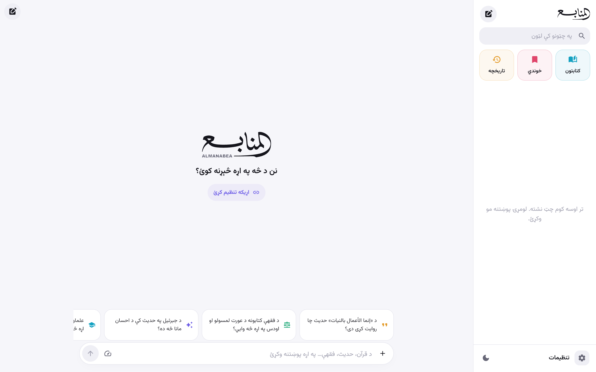

# Manabi · منابع

**Manabi** is a cross-platform (Android, iOS, Windows, macOS, Linux, Web) Islamic research assistant built with **Flutter/Dart**. It answers questions in **Pashto, Dari/Persian, Arabic and English** *only* from real pages of the [Turath](https://app.turath.io) library, retrieved through the open-source [Nusus SDK](https://github.com/mwijanarko1/nusus). Gemini is used only to plan the searches and to arrange the answer from the retrieved pages.

> منابع یو څوپلېټفارمه اسلامي څېړنیز اپلیکیشن دی. ستاسو پوښتنې ته یوازې د تراث کتابتون له حقیقي مخونو ځواب ورکوي — د کتاب نوم، مؤلف، جلد، مخ، اصلي عربي عبارت او مستقیم لینک سره. که مستند ځواب ونه موندل شي، په ښکاره یې وايي.



## How an answer is made (and why it can be trusted)

```
question ──► 1. plan (Gemini)      → 3–5 literal Arabic search queries
         ──► 2. search (Turath)    → real pages via Nusus (book, author, volume, page, URL)
         ──► 3. compose (Gemini)   → answer using ONLY the numbered pages, with [S#] markers
         ──► 4. verify (local)     → every quote is located in the real page text
```

* **Metadata never comes from the model.** Book title, author, volume, printed page, Turath page and links come from the Turath API.
* **Quotes are cut from the source.** The model only points at a passage. Manabi finds it in the page text, after normalizing diacritics, and displays the *book's own text*. Fabricated quotes are dropped (`server/src/verify.mjs`, `app/lib/core/pipeline/quote_verifier.dart`).
* **No verified evidence → no answer.** If no quote can be verified, or Turath returns nothing, the answer becomes *"No documented answer was found"*. The pages that were searched are still listed for inspection.
* **Fiqh:** for fiqh questions the four madhhab categories (Hanafi, Maliki, Shafi'i, Hanbali) are searched as well. Views are kept apart and attributed (`opinions`). Hadith gradings are only reported when a source states them. Manabi does not issue fatwas.

## Features

Chat with live progress steps · scope to a **book**, **author** or **category** · per-question answer language · numbered citation chips linked to source cards · verified Arabic quote · in-app page reader with highlighting · Turath/Shamela links · chat list (search, pin, rename, delete) · question history · saved answers · copy / share · export to **PDF**, **Markdown** and **TXT** · offline book/author/category catalog (8,124 books, 3,037 authors) · full-text Turath search · Light/Dark/System theme · Arabic text size · UI in ps/fa/ar/en.

## Repository layout

| Path | What |
| --- | --- |
| `app/` | Flutter app (all six platforms) |
| `server/` | Node.js server: Nusus SDK + Gemini; keeps the API key off devices |
| `.github/workflows/ci.yml` | tests, live end-to-end test with the real key, real-answer screenshots |
| `.github/workflows/build.yml` | builds every platform, uploads artifacts, publishes GitHub Releases |
| `tool/screenshots/` | Playwright screenshot driver used in CI |
| `installers/windows/` | Inno Setup script for the Windows `.exe` installer |

## The Gemini key (`GEMINI_API_KEY`) and security

The key is stored as the repository secret **`GEMINI_API_KEY`** (the older name `GEMINI_API_KYA` is accepted too). It is used only:

1. in CI, by the live tests and the live-answer screenshots, which run once a day and on manual runs (*Actions → CI → Run workflow*) so they don't use up the key's quota, and
2. by a deployed **Manabi server** (`server/`), as an environment variable.

It is **never compiled into the apps.** The repository is public, and a key inside an APK/EXE/web bundle can be extracted by anyone. Apps therefore connect in one of two ways (Settings → Connection):

* **Manabi server** (recommended, works everywhere, required on the web because Turath sends no CORS headers). Set the repository **variable** `MANABI_SERVER_URL`, and every build ships with that address preconfigured.
* **Direct** (Android/iOS/desktop): the user enters their own Gemini key. It is kept in the OS secure storage (Keychain/Keystore/DPAPI/libsecret).

### Run the server

```bash
cd server
npm ci
GEMINI_API_KEY=... npm start            # http://localhost:8787/api/health
# or
docker build -t manabi-server server && docker run -p 8787:8787 -e GEMINI_API_KEY=... manabi-server
```

### Gemini quota

Each answer takes 3–4 Gemini calls: planning goes to the light model (Flash-Lite); ranking the passages and writing the answer go to the main model (Flash), because they decide the quality of the sources. Each model has its own daily quota. When one model's quota runs out, the server (and the app in direct mode) moves on to the next model automatically. The free tier allows only about 20 requests per model per day, so a public deployment needs billing enabled on the Google AI project.

### Research depth and interrupted answers

The composer's gauge button (and *Settings → AI style*) chooses **quick**, **standard** or **deep** research: how many queries and books are searched, how many pages are read (up to 6 / 14 / 18 sources) and how many follow-up rounds run. If a phone app goes to the background mid-answer and loses its connection, it resumes when it comes back; the server keeps each answer for 20 minutes under the app's request id, so the retry gets the finished answer without spending Gemini quota again.

Optional env: `GEMINI_MODEL` (pins one model and turns off the fallback; default: the newest available Flash / Flash-Lite), `ALLOWED_ORIGINS`, `ASK_LIMIT`/`ASK_WINDOW_MIN` (rate limit), `TRUST_PROXY=1`, `ACCESS_TOKEN`. Any Docker/Node host works (Cloud Run, Fly.io, Render, a VPS). Then set `MANABI_SERVER_URL` in *Settings → Secrets and variables → Actions → Variables*.

API: `POST /api/ask` (JSON or SSE stream), `GET /api/search`, `/api/books/:id`, `/api/authors/:id`, `/api/pages/:bookId/:pageId`, `/api/catalog/{books,authors,categories}`, `/api/health`.

## Development

```bash
cd server && npm ci && npm test                         # 18 tests (recorded Turath responses)
GEMINI_API_KEY=... npm run test:live                    # real Turath + Gemini
cd app && flutter pub get && flutter analyze && flutter test
flutter run -d chrome --dart-define=MANABI_SERVER_URL=http://localhost:8787
```

## Builds and releases

Every push runs **Build & Release**. It produces the files below, uploads them as workflow artifacts, and publishes them to the rolling **`nightly`** pre-release. Pushing a `v*` tag creates a normal release.

| Platform | Output |
| --- | --- |
| Android | universal + per-ABI APK, AAB |
| Windows | `Manabi-windows-x64-setup.exe` installer, portable zip |
| macOS | `.dmg` and `.zip` (unsigned) |
| Linux | `tar.gz` bundle |
| iOS | unsigned `.ipa` |
| Web | zip (also deployed to GitHub Pages from `main` when Pages is enabled with source "GitHub Actions") |
| Server | `tar.gz` |

### Signing limitations

* **Android:** add `ANDROID_KEYSTORE_BASE64`, `ANDROID_KEYSTORE_PASSWORD`, `ANDROID_KEY_ALIAS`, `ANDROID_KEY_PASSWORD` secrets to sign with your own key. Without them builds are debug-signed. That is fine for side-loading, but Google Play rejects them.
* **iOS:** an unsigned `.ipa` cannot be installed on a device. Signing needs an Apple Developer Program membership, a distribution certificate and a provisioning profile. Add them as secrets and switch the iOS job to `flutter build ipa --export-options-plist=...`.
* **macOS:** the app is unsigned and not notarized, so Gatekeeper requires right-click → Open. Notarization needs a Developer ID certificate and an Apple ID app-specific password.
* **Windows:** not code-signed, so SmartScreen may warn. A code-signing certificate is needed to remove the warning.

## Sources and licences

Texts and metadata © their publishers via [turath.io](https://app.turath.io). Retrieval through [Nusus](https://github.com/mwijanarko1/nusus) (MIT); the Dart Turath client in `app/lib/core/turath/` is a port of its retrieval code. Fonts: Vazirmatn and Noto Naskh Arabic (SIL OFL). Manabi reports what the books say. It is not a fatwa; for personal rulings, consult a qualified scholar.
